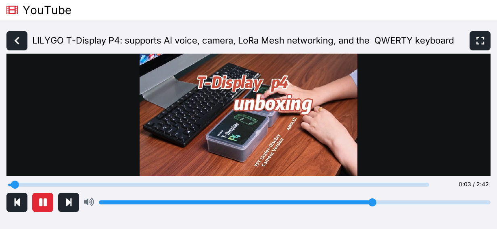

# LILYGO YouTube

**English** | [简体中文](README.zh-CN.md)

LILYGO YouTube is a native C++17 YouTube client for LILYGO UI. It runs on CM0
ARM64 Linux devices and includes an SDL2 desktop simulator for development and
testing. Search, recommendations, thumbnails, and playback are implemented in
the application; no companion computer, Node.js resolver, `yt-dlp`, or shell
pipeline is required.

## Preview

<p>
  
</p>

## Features

- **Home feed:** public topic searches provide up to 48 unique recommendations;
  refreshes rotate topics instead of using an account or viewing history.
- **Search:** keyword search returns up to 12 videos, with thumbnails loaded in
  the background. The home feed also offers refresh and load-more controls.
- **Playback:** play, pause, retry, seek, ten-second skips, volume, and an
  expanded player preserve the current result list when playback closes.
- **Native media path:** public H.264/AAC streams are resolved over HTTPS and
  played by libmpv. The default quality ceiling is 720p; 240p, 360p, 480p,
  720p, and 1080p are supported when a compatible stream is available.
- **CM0 rendering:** V4L2 M2M H.264 decoding, OpenGL ES video textures, and
  LVGL DRM/GBM/EGL composition with portrait and landscape rotation.
- **Responsive UI:** LVGL search keyboard, video cards, playback controls, and
  orientation-aware layouts are covered by host render tests.
- **Bounded background work:** HTTPS, thumbnail conversion, cancellation, and
  response-size limits keep network work away from the LVGL thread.

The client uses YouTube's internal HTTPS API, which can change without notice.
It currently supports public videos that expose direct H.264/AAC streams.
Login, age-restricted or paid content, DRM, live manifests, and dynamic
signature challenges are outside the supported compatibility range. See the
[service and network guide](docs/03-services-and-network.md) for endpoints,
timeouts, privacy, and failure behavior.

## Development Environment

Project identity and package metadata come from [`lpm.toml`](lpm.toml), while
[`CMakePresets.json`](CMakePresets.json) defines the stable `host-simulator`
and `cm0-cross` configurations. Run commands from the repository root.

### Get the Source

For an existing checkout, initialize the pinned AppKit dependency:

```sh
git submodule update --init --recursive
```

The simulator consumes `third_party/cm0-appkit` directly. It does not require a
separate AppKit installation or a network download of LVGL when the submodule
is initialized.

### Host Dependencies

Use CMake 3.21 or later, CTest and CPack, Python 3.11 or later, a C++17
compiler, `pkg-config`, `patch`, SDL2, FreeType, json-c, libcurl, libmpv, and
FFmpeg. The host simulator also needs a graphical desktop session. On Debian
12 or Ubuntu 24.04:

```sh
sudo apt update
sudo apt install build-essential cmake git pkg-config patch libsdl2-dev \
  libfreetype6-dev libjson-c-dev libcurl4-openssl-dev libmpv-dev ffmpeg \
  ca-certificates python3 python3-venv python3-pip
```

On macOS, install the Xcode Command Line Tools and the equivalent Homebrew
packages:

```sh
xcode-select --install
brew install git cmake pkg-config patch sdl2 freetype json-c curl mpv ffmpeg python
```

Install LPM in a project-local environment if it is not already on `PATH`:

```sh
python3 -m venv .venv
. .venv/bin/activate
python -m pip install "git+https://github.com/LILYGO-UI/lpm.git"
lpm --version
```

Reactivate `.venv` in each new shell. CMake also accepts an existing LPM with
`-DLPM_EXECUTABLE=/absolute/path/to/lpm`.

## Build and Test

### Desktop Simulator

LPM is the shortest path for a normal development cycle:

```sh
lpm start --foreground
```

Use `lpm start --no-build --foreground` to reuse an existing build. The
underlying CMake commands are:

```sh
cmake --preset host-simulator
cmake --build --preset host-simulator --parallel
ctest --preset host-simulator
```

The Debug build is written to `build/host-simulator`. Render snapshots are
written as `youtube-portrait.ppm` and `youtube-landscape.ppm`.
Use `lpm test` to configure, build, and run the same test suite in one command.

| Test | Coverage |
| --- | --- |
| `youtube-core` | Video ID validation, JSON parsing, stream selection, limits, and duration formatting |
| `youtube-view-model` | Search/recommendation state, cancellation, thumbnails, controls, and playback commands |
| `youtube-render-portrait` | Rendering and interaction at `568 x 1232` |
| `youtube-render-landscape` | Rendering and interaction at `1232 x 568` |

Inspect both snapshots after UI changes; passing assertions do not verify visual
spacing, text fallback, or clipping.

### Opt-in Playback Checks

These commands contact YouTube or open local media and are not part of the
default offline test suite:

```sh
cmake --build --preset host-simulator --target youtube-player-smoke
build/host-simulator/youtube-player-smoke /absolute/path/to/video.mp4
build/host-simulator/youtube-player-smoke TFWhoT9B1XU
build/host-simulator/youtube-player-smoke /absolute/path/to/video.mp4 --audio
build/host-simulator/youtube-player-smoke /absolute/path/to/video.mp4 \
  --audio-file /absolute/path/to/audio.m4a --audio
build/host-simulator/youtube-render-ui 568 1232 /tmp/youtube-live.ppm live
build/host-simulator/youtube-render-ui 568 1232 /tmp/youtube-home.ppm recommendations
```

The smoke test is silent unless `--audio` is supplied. `live` exercises search,
thumbnail loading, stream resolution, and embedded playback; `recommendations`
exercises the home feed without opening the player.

### CM0 Device Build

Device builds need an AArch64 cross compiler and the CM0 BSP. On Debian or
Ubuntu install `gcc-aarch64-linux-gnu` and `g++-aarch64-linux-gnu`; on Apple
Silicon use `brew install aarch64-unknown-linux-gnu`. Then run:

```sh
lpm pack
```

Equivalent CMake and CPack commands are:

```sh
cmake --preset cm0-cross
cmake --build --preset cm0-cross --parallel
cpack --config build/cm0-cross/CPackConfig.cmake -B dist
```

The first cross configuration downloads the pinned BSP into `.cache`. Older
CM0 BSPs without EGL, GLES2, and GBM development files can use the project-local
GPU SDK overlay:

```sh
sh tools/sync-gpu-sdk.sh pi@192.168.8.206
cmake --preset cm0-cross
```

Override the overlay with `-DYOUTUBE_GPU_SDK_ROOT=/absolute/path/to/overlay`,
or configure `-DCM0_DRM_OPENGL=OFF` for the software display backend. CPack
writes `dist/lilygo-ui-youtube_0.1.0_arm64.deb`; install it on the device with
`apt install` so Debian resolves the declared runtime dependencies.

The target package requires `libmpv2 >= 0.38`, `libcurl4t64`, json-c, FFmpeg,
DRM/EGL/GLES2/GBM, FreeType, CA certificates, and `lilygo-ui-appkit-dev >= 0.1.0`.
AppKit supplies the device's shared runtime fonts. The GPU SDK sync script
downloads and extracts development packages without installing them on the board.

The source and homepage URLs in `lpm.toml` still point to the template repository;
set them to the final repository before publishing.

### Runtime Diagnostics and Reproduction

| Variable | Effect |
| --- | --- |
| `LILYGO_YOUTUBE_DEBUG=1` | Logs renderer, decoder, frame/drop counts, buffering, cache, video size/FPS, and A/V offset. |
| `LILYGO_YOUTUBE_TEST_MEDIA=/path/to/video.mp4` | Opens local media in the complete application for an offline playback check. |
| `LILYGO_YOUTUBE_TEST_VIDEO=<video-id>` | Starts the normal resolver and player without search or touch input. |
| `LILYGO_YOUTUBE_TEST_QUALITY=240\|360\|480\|720\|1080` | Selects the requested playback ceiling for `TEST_VIDEO`; invalid values keep the default. |

`LILYGO_YOUTUBE_TEST_MEDIA` takes precedence when both test inputs are set.
Network playback requires access to YouTube, `i.ytimg.com`, and
`*.googlevideo.com`, plus system CA certificates. Proxy support depends on the
native library handling each request; see the service guide for request details.

On CM0, playback uses the default ALSA device at 48 kHz, signed 16-bit stereo
PCM. `LILYGO_YOUTUBE_DEBUG=1` adds `[youtube-audio]` diagnostics for the actual
backend and output format. See [CM0 graphics and playback verification](docs/02-cm0-performance.md)
for measured 720p/1080p limits, buffering, and display handoff behavior.

## Troubleshooting

| Symptom | Action |
| --- | --- |
| `lpm` or project metadata is missing | Activate `.venv`, install LPM, or set `LPM_EXECUTABLE`. |
| `LilyGoUI` or LVGL cannot be found | Run `git submodule update --init --recursive`. |
| SDL2, FreeType, json-c, libcurl, or libmpv is missing | Install the host development packages; for cross builds, check the target sysroot. |
| Homebrew libraries are not found | Configure with `-DCMAKE_PREFIX_PATH="$(brew --prefix)"`. |
| The player reports an unsupported video | Try a public H.264/AAC video and a supported quality ceiling; age restrictions, DRM, and live streams are not implemented. |
| Playback stalls or thumbnails fail | Check DNS, proxy settings, CA certificates, and access to YouTube, `i.ytimg.com`, and `googlevideo.com`. |
| Device GPU headers are missing | Populate `.cache/gpu-sdk` with `tools/sync-gpu-sdk.sh`, or use the software display backend. |

## Documentation

| Guide | Contents |
| --- | --- |
| [Architecture overview](docs/00-overview.md) | Data flow, worker ownership, playback lifecycle, cancellation, and failure handling |
| [UI development guidelines](docs/01-user-interface.md) | LVGL layout, typography, ownership, orientation, and render-test requirements |
| [Services and network](docs/03-services-and-network.md) | HTTPS endpoints, stream and thumbnail requests, limits, privacy, and offline behavior |
| [CM0 graphics and playback verification](docs/02-cm0-performance.md) | Device pipeline, measured performance, buffering, and validation evidence |

## Source Layout and Licensing

- `src/pages/youtube/`: Model, ViewModel, and LVGL View for search, feed, and playback.
- `src/services/http.*`: bounded HTTPS requests through system libcurl.
- `src/services/youtube_service.*`: worker-thread requests and thumbnail jobs.
- `src/services/player.*`: libmpv playback, hardware decoding, OpenGL textures, and simulator rendering.
- `src/services/process.*`: bounded, shell-free FFmpeg invocation for thumbnail conversion.
- `tests/`: core, ViewModel, render, audio, and GPU smoke checks.

The application does not vendor or redistribute a full media stack. Runtime
libraries are supplied by the operating system. Upstream notices for the
public headers and shared AppKit font licenses are installed in the Debian
package under `/usr/share/doc/lilygo-ui-youtube`.
